# LUCY architecture and feasibility review

> Standalone update: background requirements reviews, direct provider adapter, durable jobs and progress polling are now implemented. See [standalone.md](standalone.md) for current behavior and limitations. The original design and initial-slice descriptions below remain historical where they describe these features as future work.

## Current repository and scope

The workspace was empty at intake. There was no code, deployment, dependency manifest, or migration platform to reuse. The user subsequently prioritized agent definitions and requirements interviewing, with a real application migration deferred until later. This implementation therefore leads with planning; the synthetic fixture exists only as optional developer validation.

## Critical review

The vision is feasible as a staged, supervised engineering platform, not as a universal autonomous correctness oracle. The following assumptions must be validated before expanding implementation:

1. Independent role names do not establish independent verification. A verifier must consume immutable artifacts, have separate write permissions and test ownership, and use checks whose expected behavior was not chosen by the implementer. Model diversity alone does not fix shared blind spots.
2. Repository discovery cannot infer complete business intent. Verified observations, user assertions, hypotheses and unknowns need distinct provenance. An interview answer is a requirement, not runtime evidence.
3. Compatibility may conflict with security and intentional bug fixes. Require explicit exceptions tied to scenarios, versions and approvers. Never silently normalize mismatches.
4. “Self-improving” means evidence-backed knowledge reuse, not automatic model-weight or policy changes. Retrieval can leak proprietary information unless tenant and project filters precede ranking.
5. Time estimates require comparable history and calibrated residuals. The prototype intentionally produces no completion date. Averaging a fast metadata scan and a long soak test would be misleading.
6. Universal multi-language runtime instrumentation is a platform program. Start with one language and one deployment topology; validate each adapter independently.
7. A local subprocess is not isolation. No untrusted repository execution is supported here. Network control, resource enforcement and credential brokerage must exist before live implementation agents.
8. Ten mandatory gates cannot all be “passed” by one demonstration. Gate applicability needs risk-based policy and approved exclusions; short allocation probes cannot establish soak or cloud readiness.
9. Eighteen logical agent roles should not mean eighteen always-running workers or services. Demand-driven roles reduce cost, contention and correlated chatter.
10. Approval before substantial work can stall automation unless it is bound to a specific contract, revision, scope and environment. Planning approval is deliberately distinct from permission to edit or deploy.

## Recommended modular architecture

Start with a modular monolith and a separate execution boundary. In this slice, Python standard-library modules and SQLite avoid infrastructure prerequisites. The UI is buildless HTML/CSS/JS served from the same loopback origin. This choice optimizes inspectability and setup; it is not the recommended public production server.

```mermaid
flowchart LR
  UI[Control plane] --> API[Local API / future identity gateway]
  API --> Project[Projects and versioned requirements]
  Project --> Plan[Interview and strategy planning]
  Plan --> Approval[Human approvals]
  Approval --> Orchestrator[Persistent orchestrator]
  Orchestrator --> Registry[Agent registry / capability broker]
  Registry --> Sandbox[Future isolated workers]
  Sandbox --> Evidence[Immutable evidence and telemetry]
  Evidence --> Verify[Independent verification and guardian]
  Verify --> Knowledge[Scoped engineering knowledge]
  Verify --> Forecast[Forecast and notifications]
  Verify --> UI
```

Production evolution: transactional PostgreSQL project/workflow storage; content-addressed object artifacts; telemetry storage with downsampling; separate job queue and leased workers; project-scoped search with semantic retrieval only when lexical retrieval is insufficient. Keep logical discovery, testing, diagnostics, security, critique and resilience modules separate in code. Split services when privileged isolation or workload scale requires it, not just because agents have different names.

## Persistent workflow

Planning: `interviewing → strategy_review → planned`. Missing answers retain `interviewing`; edits from any planning state create a new contract and clear approval. `planned` does not imply executable readiness. A future transition to implementation requires repository identity, resolved measurable thresholds, approved strategy, budget and sandbox capability.

Optional fixture: `awaiting_approval → ready → review_required`. Between steps, `ready ↔ paused`; active states can become `cancelled`. A failed step enters `blocked`; explicit retry is limited to two attempts. Eight fixed steps cap iteration. Cursor, task result, immutable evidence and event commit in one transaction. A crash before commit replays the current fixture step; fixture side effects are confined to a disposable generated application file. Production side effects need idempotency keys and an outbox, not claims of exactly-once execution.

The current server serializes operations. It has no background worker, lease expiry, mid-command pause, or distributed locks. A worker timeout bounds the fixed probe. Pause takes effect between steps. A production workflow requires leases, heartbeats, cancellation propagation, process-group termination, global budgets and stagnation detection based on unchanged findings.

## Storage design

Implemented tables: `projects(id, body)`, `events(seq, project_id, at, body)`, `evidence(id, project_id, sha256, body)`. Foreign keys attach records to projects. JSON project snapshots hold contract, strategy, gates, assignments and forecast history. Contract versions are also immutable evidence records. Evidence hashes provide reproducible linking, not tamper-proof storage: a local database owner can alter both data and hashes.

Before multiple users: normalize organizations, memberships, project roles, repository revisions, contracts, approvals, workflows, tasks, attempts, tool calls, artifacts, findings, gate evaluations, knowledge versions and forecast versions. Use optimistic project revision checks and database migrations. Approvals reference actor identity, contract hash, source commit, strategy, environment, cost cap and expiry. Gate results reference source revision, workload and evidence hash; new code invalidates affected evidence. Store secrets in a broker, never JSON records.

## Differential verification

Fixture implementation executes identical disclosed scenarios in fresh processes. It compares input/scenario identity and exact JSON output without normalization, including missing scenarios. Decimal rounding and negative/empty input contracts are covered. Each run retains source hash, runtime version, inputs, outputs and workload metadata. A distinct deterministic verifier checks the repair; this is structural separation, not independent AI or human assurance.

Production adapters must capture response/error contracts, database effects, emitted events, external calls and timing-sensitive side effects. Reset fixtures and seeded randomness, virtualize time where authorized, and compare canonicalized representations only under explicit semantic rules. Use side-effect proxies and disposable databases. Capture minimal reproducible mismatches, preserve failing tests, and ensure implementations cannot edit verifier fixtures. Property, integration and end-to-end tests complement differential checks; legacy bugs require approved exceptions.

## Runtime and resilience architecture

The fixture measures Python traced allocations after warm-up and garbage collection, six equal batches of 200 requests. It flags retained growth over the disclosed 64 KiB demo budget. This excludes native memory, process RSS, container limits, GC pauses, sockets, threads and production loads. The intentionally retained bytearrays produce measurable growth; no inference about real application memory stability is made.

Future diagnostics adapters: RSS/heap/native allocation, post-GC retained memory, allocation and pause distributions, thread/FD/socket/pool counts and container headroom. Compare repeated equivalent workloads; use robust trend estimates after warm-up and report sampling uncertainty. Profile overhead itself must be measured. Soak tests record exact duration and coverage of expiry, renewal, scheduled work and cumulative degradation. Short probes must never satisfy multi-hour requirements.

Cloud validation belongs in disposable, explicitly approved nonproduction namespaces. A scenario defines replicas, load, data, fault, safety envelope, recovery objective, stop conditions and rollback. Validate idempotency, duplicate jobs/messages, session/state consistency, concurrent updates, connection totals across replicas and graceful replacement. Network partitions, instance loss and dependency outages need narrowly scoped fault permissions. No fault injection is implemented in this slice.

## Knowledge lifecycle

Current fixture records ID, version, source project, technology, problem, cause, mitigation, evidence links, status, date, limitations and reuse conditions. The UI exposes only the current project's records. This is intentionally not cross-project retrieval.

Future records use statuses hypothesis → provisionally supported → verified, with disproven/superseded/retracted/archive transitions. Verification requires fresh evidence and a verifier distinct from the proposing actor. Apply tenant/project authorization before retrieval; deduplicate by normalized problem and version range; retain contradictions rather than silently overwrite them. Rank by environment match, version overlap, evidence strength and recency. A reused pattern remains a recommendation until destination validation. Measure investigation time, recurrence, rework and coverage changes against comparable baselines.

## Forecast algorithm and uncertainty

Current forecasts report observed active seconds, remaining fixture tasks and a linear critical path. Completion ranges remain null: no calibrated comparable history exists. For planning projects, an empty task graph means unknown work, not zero remaining work.

Future forecasts use a dependency DAG, required resource classes, empirical duration distributions conditioned on task/stack/size, rework probability and explicit human wait time. Monte Carlo samples schedule tasks subject to worker capacity and mandatory soak duration. Report P10/P50/P90 wall time and active effort separately; these are percentiles, not assurance confidence. Identify critical-path frequency, bottlenecks and contributions to forecast shifts. Cold-start priors must be labeled and updated with observed durations; backtest interval coverage before advertising calibrated confidence. Scope changes invalidate comparables. Unknown human delays should yield conditional ranges or no date.

## UI and security boundaries

Implemented navigation: Mission Control, Requirements Interview, Agent Registry, Strategy & Approvals, Assurance & Evidence, Engineering Knowledge. The first action is project creation; no repository or sample migration is required. Each interview answer is explicitly saved. The dashboard distinguishes registered definitions from active execution. Unknown gates remain visible, with no overall numeric score. The current UI refreshes after actions; live telemetry is not implemented.

Loopback binding, strict Host checks, same-origin checks, an in-memory action token, no CORS, fixed static routes, escaped UI output and CSP reduce accidental browser-origin attacks. They are not enterprise authentication; any local process can access the service. HTTP path-based repository intake is deliberately absent. CLI inspection never executes source and skips symlinks/hidden files. Interview text can contain sensitive information: users must not paste secrets; comprehensive redaction is not implemented.

Production controls: OIDC identity, project/organization RBAC, scoped artifact URLs, audited approvals, signed append-only evidence, encryption and retention policies, secret broker, restricted egress, read-only mounts, disposable containers or microVMs, CPU/memory/PID/disk/time quotas and production access denied by default. Prompt instructions are not an authorization mechanism. Tool dispatch enforces capabilities regardless of model output.

## Reference basis

- Python SQLite transaction and threading behavior: https://docs.python.org/3.13/library/sqlite3.html
- Python traced-allocation scope and snapshots: https://docs.python.org/3/library/tracemalloc.html

These references informed the single-threaded connection model and allocation-measurement limitations. They do not substantiate production readiness.
